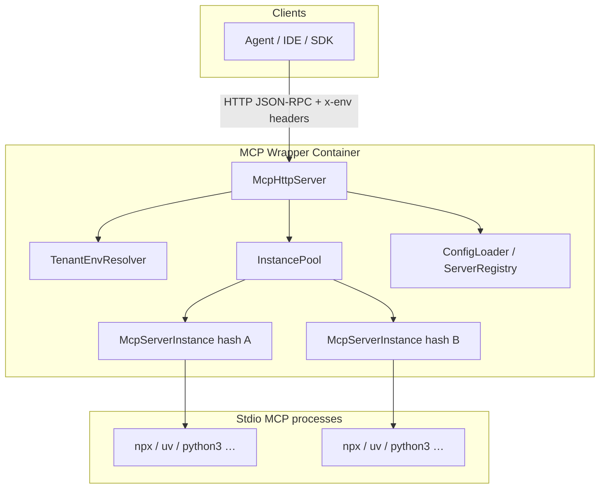
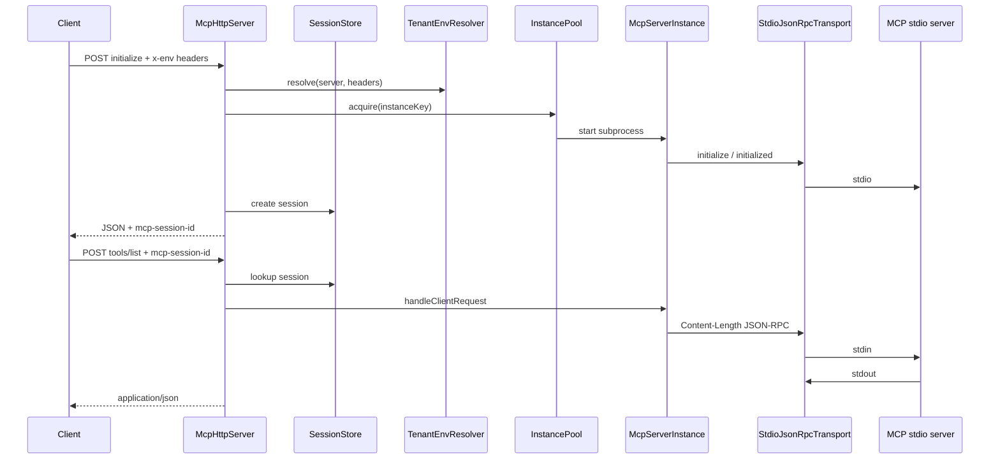
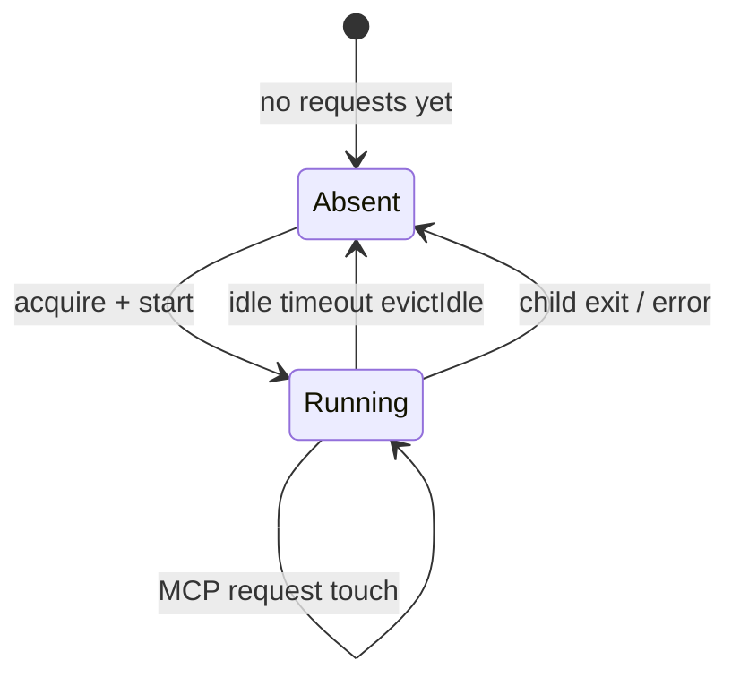

# Architecture

## System context



The wrapper is a single Node.js process that manages many **stdio** child processes. It does not modify upstream MCP server code.

## Design principles

| Principle | Implication |
|-----------|-------------|
| Config reuse | `mcpServers` matches Cursor `mcp.json`; minimal extra schema |
| Convention over configuration | `env` keys + `x-<KEY>` headers define tenant env and hash |
| Global ops policy | Idle minutes and logging via environment variables |
| Class-first modules | One primary class per boundary; `McpWrapperApplication` wires dependencies |
| Safe observability | Metrics aggregate by server/tool; secrets stay out of labels and logs |

## Module structure (planned)

```text
src/
  index.js
  McpWrapperApplication.js
  LoggerFactory.js
  paths.js                  # container vs local paths (resolveRuntimePaths)
  routers/
    McpHttpServer.js
    StreamableHttpHandler.js
    McpCatalogMarkdown.js
    McpCatalogHtml.js
    SseWriter.js
  managers/
    ConfigLoader.js
    ServerRegistry.js
    ServerDefinition.js
    InstancePool.js
    McpServerInstance.js
    SessionStore.js
    IdleEvictionPolicy.js
    StdioJsonRpcTransport.js
  utils/
    TenantEnvResolver.js
    TenantEnvError.js
    MetricsRegistry.js
  types.js                  # shared JSDoc typedefs (Logger, HTTP, child process)
```

## Component responsibilities

### `McpWrapperApplication`

Composition root: load config, create logger and metrics registry, start HTTP server, schedule idle eviction, register shutdown hooks.

### `ConfigLoader` / `ServerRegistry` / `ServerDefinition`

- Read **only `mcp.json`** in the runtime config directory for `mcpServers`. Other files in that folder (SSH MCP config, keys, etc.) are ignored by the loader.
- Merge `mcpServers` entries into a registry keyed by server name.
- `ServerDefinition` holds `command`, `args`, and the list of `env` keys with optional static defaults from JSON.

### `TenantEnvResolver`

For a given server and request headers:

1. For each key in `server.envKeys`, read `x-<KEY>` (case-insensitive).
2. Resolve value: header ?? JSON default.
3. Fail if still missing/empty.
4. Compute `instanceKey = SHA-256(serverName + canonical sorted key=value pairs)`.

Returns `{ env, instanceKey }` for the pool.

### `InstancePool`

- **`acquire(instanceKey, factory)`** — return existing `McpServerInstance` or create, start, and cache.
- **`touch(instanceKey)`** — update last-used timestamp.
- **`evictIdle()`** — called on interval; closes instances where `now - lastUsedAt > idleMs()`.

Concurrency: use a per-key pending promise so two simultaneous first requests for the same hash do not double-spawn.

### `IdleEvictionPolicy`

Reads **`MCP_WRAPPER_IDLE_MINUTES`** only (global). Converts to milliseconds; invalid values fall back to a safe default (e.g. 15 minutes).

### `McpServerInstance`

- **`spawn(command, args, { env: { ...process.env, ...tenantEnv } })`**
- Owns **`StdioJsonRpcTransport`**
- On first use: MCP **`initialize`** + **`notifications/initialized`**
- **`request(jsonRpc)`** — forward to transport, touch idle timer
- **`close()`** — terminate subprocess (SIGTERM, optional SIGKILL after drain timeout)

Child **stderr** is logged at a controlled level without echoing tenant secrets.

### `StdioJsonRpcTransport`

**Content-Length** framed JSON-RPC on stdin/stdout (LSP-style, matching the official MCP SDK):

- Parse `Content-Length` headers from stdout buffer; write the same framing to stdin
- Correlate responses by JSON-RPC `id`
- Emit **`notification`** events for server-initiated messages (forwarded to SSE clients)

### `SessionStore` / `StreamableHttpHandler`

- **`SessionStore`**: opaque `mcp-session-id` → `{ serverName, instanceKey }`; invalidate when instance evicted
- **`StreamableHttpHandler`**: Streamable HTTP POST/GET on `/mcp/:serverName`; creates session on first `initialize`; bridges stdio notifications to SSE via **`SseWriter`**

### `McpHttpServer`

- Route **`GET /`** (HTML catalog; **`GET /catalog.md`** or `Accept: text/markdown` for raw Markdown), **`POST` / `GET /mcp/:serverName`**, plus **`/health`** and **`/metrics`**
- Delegate MCP traffic to **`StreamableHttpHandler`**

### `McpCatalogMarkdown`

- Pure generator: **`generate(registry, { baseUrl, hostHeader })`** → Markdown
- Lists configured servers, `x-<ENV>` headers, Streamable HTTP steps, and client **`mcp.json`** snippets without leaking sensitive config values
- **`PUBLIC_BASE_URL`** (optional) or request **`Host`** header for absolute URLs in examples

### `McpCatalogHtml`

- Renders catalog Markdown with **`marked`** and **`github-markdown-css`** (light/dark via `prefers-color-scheme`)
- Used for **`GET /`** when the client does not request `text/markdown`

## Request sequence



## Tenancy and hashing

**Canonical form** (conceptual):

```text
instanceKey = SHA256(
  serverName + "\0" +
  join("\0", sorted(envKeys.map(k => k + "=" + env[k])))
)
```

Properties:

- Same server + same resolved env → same subprocess.
- Changing any declared `env` value (via header or config) → new subprocess.
- Keys not listed under `env` in config are not part of tenant identity (use container-level env for global settings like `NODE_ENV`).

**Security notes:**

- Do not use `instanceKey` as a Prometheus label (unbounded cardinality).
- Do not log full hashes or header values; optional `instanceKeyPrefix` (first 8 hex chars) in logs for support.

## Idle eviction



Eviction loop runs on a fixed interval (e.g. every 60s), compares `lastUsedAt` to **`IdleEvictionPolicy.idleMs()`**, then **`close()`** and remove from map.

Future enhancement: drain in-flight tool calls before kill with a max wait.

## Container image

Published as **`ghcr.io/elad-bar/mcp-streamable-http-bridge`** (`latest` and commit SHA tags) via [`.github/workflows/ci.yml`](../.github/workflows/ci.yml) on push to `main`.

Base image includes:

- Node.js (wrapper runtime)
- **npx** (Node/npm toolchain)
- **uv** (Astral)
- **python3**

Mount host **`config/`** at **`/config`** (read-only) and **`logs/`** at **`/app/logs`**. Paths are fixed in code, not environment variables.

## Logging architecture

**`LoggerFactory`** builds a shared Winston logger:

| Transport | Behavior |
|-----------|----------|
| Console | Always enabled (colorized text) |
| File | **`/app/logs/mcp-wrapper.log`**, human-readable lines; rotate on **`LOG_MAX_SIZE`** only (default `10m`), keep **`LOG_MAX_FILES`** (default `5`); archived files use numeric suffixes (e.g. `.1`), not dates |

Pretty lines look like: `{timestamp} [McpServerInstance:weather] {level}: {message} (tenant=…, session=…, pid=…)` — bracket matches `logger.child({ component })` (and `:server` when set).

Level from **`LOG_LEVEL`** (default `info`). Timestamps and stack traces on errors.

Inject **`logger.child({ component, server })`** into pool, HTTP, and instance modules. MCP child stderr is prefixed in the message and tagged with tenant/session (when in an RPC) and pid. Known noisy child startup lines are logged at **debug** unless **`LOG_LEVEL`** is `debug` (or finer), so they appear only when you turn logging up.

## Metrics architecture

**`MetricsRegistry`** wraps `prom-client` and registers:

| Metric | Type | Labels | When updated |
|--------|------|--------|--------------|
| `mcp_servers_configured` | Gauge | — | After config load |
| `mcp_instances_active` | Gauge | `server` | Pool acquire/evict/exit |
| `mcp_http_requests_total` | Counter | `route`, `status_class` | HTTP handler |
| `mcp_rpc_requests_total` | Counter | `server`, `mcp_method` | After parsing MCP method |
| `mcp_tool_calls_total` | Counter | `server`, `tool` | `tools/call` only |
| `mcp_rpc_duration_seconds` | Histogram | `server`, `mcp_method` | Around instance.request |

Default Node/process metrics may be collected on the same registry.

**Cardinality policy:** no `instanceKey` or full tenant id on metrics. Per-tenant troubleshooting uses structured logs.

Scrape **`GET /metrics`** on **`PORT`** unless a split metrics port is added later.

## Configuration vs environment

| Concern | Source |
|---------|--------|
| Which MCP servers exist | Config dir JSON (`mcpServers`) |
| Command line | `command`, `args` in JSON |
| Tenant env keys and defaults | `env` in JSON + `x-*` headers |
| Idle shutdown | `MCP_WRAPPER_IDLE_MINUTES` |
| Log rotation | `LOG_MAX_SIZE`, `LOG_MAX_FILES`, … |
| Listen port | `PORT` |

## Failure modes

| Event | Behavior |
|-------|----------|
| Invalid config at startup | Fail fast; log error; non-zero exit |
| Missing tenant header/value | Reject before spawn; 401/400 |
| JSON-RPC error from child | Return MCP error envelope to client |
| Child exit | Remove from pool; next request respawns |
| Eviction during long tool call | Prefer drain + timeout; document max tool duration vs idle minutes |

## Extension points

- **Streamable HTTP** session mapping → HTTP layer only
- **Max instances per server** → `InstancePool` + 503
- **Separate metrics port** → `McpWrapperApplication` second listener
- **Header prefix** → currently fixed `x-<ENV>`; could env-prefix if ever needed

## Related reading

- [Product overview](product.md)
- [README](../README.md)
